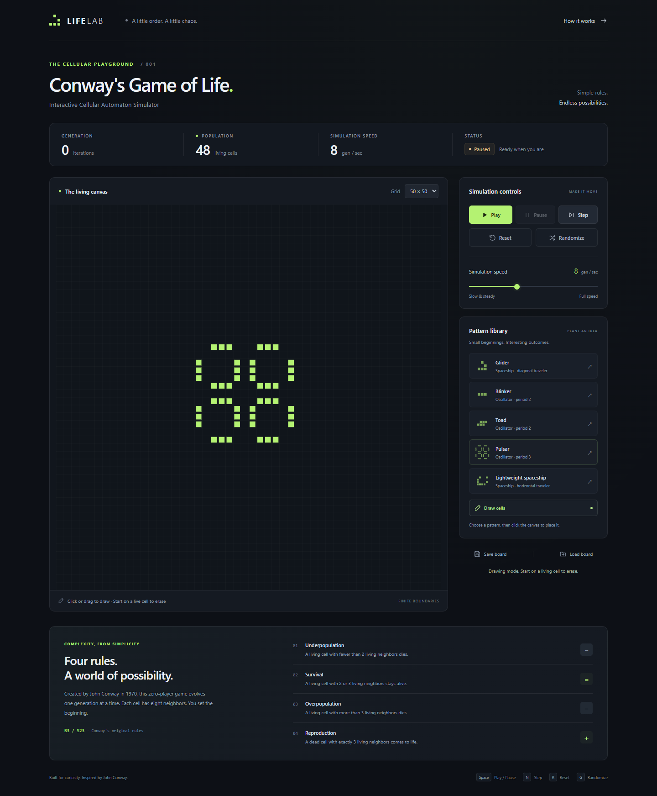

# Conway's Game of Life · Life Lab

A responsive, interactive cellular automaton sandbox built with HTML, CSS, vanilla JavaScript, and Canvas. Draw a beginning, plant a pattern, and watch complex behavior emerge from four simple rules.

This university AI-assisted software engineering project emphasizes mathematical correctness, a polished interface, understandable modules, real incremental Git history, and reproducible tests. There is no framework, build step, backend, database, external font, or runtime package dependency. Playwright is used only during development.

## Preview and deployment

**[Open the live sandbox](https://yanishimoo.github.io/conways-game-of-life/)** · [GitHub source and commit history](https://github.com/yaniShimoo/conways-game-of-life)

GitHub Pages was verified with HTTP 200 and all 12 browser tests passed against the public site on 2026-11-17.



## Features

- Finite 50 × 50 world by default; all cells update simultaneously into a new buffer.
- Mouse, pen, and touch drawing and erasing with consistent drag mode and interpolation.
- Play, Pause, Step, Reset, and Randomize at 25% initial density.
- Live generation, population, speed, and Running/Paused statistics.
- Adjustable speed from 1 to 20 generations per second, driven by one animation-frame chain.
- Glider, Blinker, Toad, Pulsar, and Lightweight Spaceship, with miniature previews and descriptions.
- Translucent placement preview; invalid edge placements are rejected with feedback.
- Dark theme, responsive panels, square high-density Canvas, and reduced-motion support.
- Optional 30 × 30 and 70 × 70 grids, local save/load, keyboard shortcuts, and keyboard Canvas editing.
- Original brief and an honest AI development log with actual milestones and verification results.

## Run locally

Install Node.js 22 or later for the included development server. The application itself needs only a modern browser.

```sh
git clone https://github.com/yaniShimoo/conways-game-of-life.git
cd conways-game-of-life
npm start
```

Open **http://127.0.0.1:4173**. No `npm install` is required to run the app or engine tests. Alternatively, serve this directory using any static HTTP server, such as `python -m http.server 8000`. Use HTTP rather than opening `index.html` directly, because browsers restrict ES module imports on `file://` URLs.

## Controls

| Control | Behavior | Shortcut |
| --- | --- | --- |
| Play / Pause | Run, stop, and resume without losing the board or generation | Space |
| Step | Advance exactly once while paused | N |
| Reset | Pause, clear every cell, and reset generation to zero | R |
| Randomize | Pause and create a fresh board at roughly 25% density | G |
| Speed | Change the rate immediately, including while running | Slider / arrow keys |
| Pattern library | Pause and select a preset, then click/tap the Canvas to place it | Tab + Enter |
| Draw cells | Return to normal drawing | Escape |
| Grid size | Pause and clear the board at the selected dimensions | Select menu |
| Save / Load board | Store or restore one board and its generation in this browser | Buttons |

**Drawing:** click a dead cell to make it live; click a live cell to erase it. Dragging keeps the action chosen by the first cell. The board is editable while paused. Touch uses the same behavior; drag on the surrounding page to scroll.

**Patterns:** the selected pattern's top-left corner anchors to the chosen cell. Its rectangular footprint is replaced, including dead cells; everything outside the footprint is preserved. A red preview indicates an invalid placement, and clicking it leaves the board unchanged. On touch devices the library miniature is the preview before tapping to place. Selection remains active for repeated placement.

**Keyboard Canvas editing:** focus the Canvas with Tab, move a cell cursor with the arrow keys, and press Enter to toggle a cell or place the selected pattern. Global letter/Space shortcuts ignore form inputs, buttons, links, modifier combinations, and repeated keydown events.

**Persistence:** Save stores a single board locally under `life-lab-board`. Loading validates its shape and values before replacing the current board. Saving again replaces that slot. Clearing browser storage removes it; blocked or full storage produces feedback. This app sends no board data to a server.

**Background behavior:** switching away from the tab pauses a running simulation. Press Play when returning. This prevents a large backlog of generations and conserves resources.

## Conway's four rules

Each cell considers its eight immediate neighbors:

1. A living cell with fewer than two living neighbors dies (underpopulation).
2. A living cell with two or three living neighbors survives.
3. A living cell with more than three living neighbors dies (overpopulation).
4. A dead cell with exactly three living neighbors becomes alive (reproduction).

This is **B3/S23**. Every cell sees the same previous generation. Cells beyond the finite grid are dead; the world does not wrap.

| Preset | Behavior |
| --- | --- |
| Glider | Moves one cell diagonally every four generations |
| Blinker | Period-two oscillator |
| Toad | Period-two oscillator |
| Pulsar | Period-three oscillator |
| Lightweight Spaceship (LWSS) | Moves two cells horizontally every four generations |

Moving patterns can eventually encounter the finite boundary and change or disappear.

## Project structure

```text
index.html                 Semantic interface, inline SVG icons, and rule explanations
css/styles.css             Responsive dark theme and interaction states
js/
  simulation.js            DOM-free finite-grid engine and pattern placement
  renderer.js              High-DPI Canvas, pointer interaction, and keyboard cursor
  clock.js                 Single animation loop, pause/resume, and timing
  patterns.js              Five pattern definitions and miniature SVG previews
  app.js                   Controls, statistics, shortcuts, and validated local saves
tests/
  simulation.test.js       Rules, boundaries, simultaneous updates, and basic patterns
  patterns.test.js         Oscillator periods, spaceship motion, and safe placement
  clock.test.js            Duplicate-loop prevention, cancellation, and speed changes
  interface.spec.js        Real-browser interaction, touch, and responsive checks
tools/serve.js             Dependency-free local HTTP server
playwright.config.js       Browser tests; supports local and deployed base URLs
docs/
  original-project-brief.txt  Exact attached project request
  development-log.md       Actual AI-assisted workflow, issues, and commit references
  screenshots/            Captured desktop and mobile interfaces
LICENSE                    MIT
```

## Testing

Run the dependency-free engine and clock suite:

```sh
npm test
```

Install development-only browser tooling and run the interface suite:

```sh
npm ci
npm run test:browser
```

The browser configuration uses installed **Google Chrome**. Install Chrome first if it is unavailable, or change `channel` in `playwright.config.js` and install the matching Playwright browser. Playwright starts the local server automatically if it is not already running.

To test a deployment, set `TEST_BASE_URL` to the complete site URL with a trailing slash before running `npm run test:browser`. For PowerShell:

```powershell
$env:TEST_BASE_URL = 'https://yanishimoo.github.io/conways-game-of-life/'
npm run test:browser
Remove-Item Env:TEST_BASE_URL
```

Verified during development: **15 engine/pattern/clock tests and 12 Chrome interface tests passed**. The interface suite covers mouse drawing and erasing, emulated touch taps and drags, all five presets, invalid placement, controls, speed updates, shortcuts, persistence, invalid stored data, and widths of 320, 390, 768, 1024, and 1440 pixels. It also checks for initial browser console/runtime errors. Screenshots were visually reviewed at 390 and 1440 pixels.

Touch testing is browser emulation. Physical devices, Firefox, and Safari have not been tested. See the development log for deployment verification and exact test history.

## Publishing to GitHub Pages

This is a buildless static app. Publish the **`main` branch, repository root (`/`)** through **Settings → Pages → Deploy from a branch**. The `.nojekyll` file disables Jekyll processing. Paths are relative, so the app works under a repository subpath. No environment variables, credentials, or server are needed by the published site.

## AI-assisted development

The user supplied the scope and authorized autonomous implementation and GitHub publication. Codex implemented the files, ran tests, reviewed browser screenshots, fixed observed issues, and created commits as stages were completed. The user completed browser-based GitHub authorization. No development history was manufactured or rewritten.

The [development log](docs/development-log.md) preserves the process and relevant commit hashes; the [original brief](docs/original-project-brief.txt) preserves the actual request. Git history is the source of truth for full hashes and timestamps.

## License

MIT — see [LICENSE](LICENSE).
